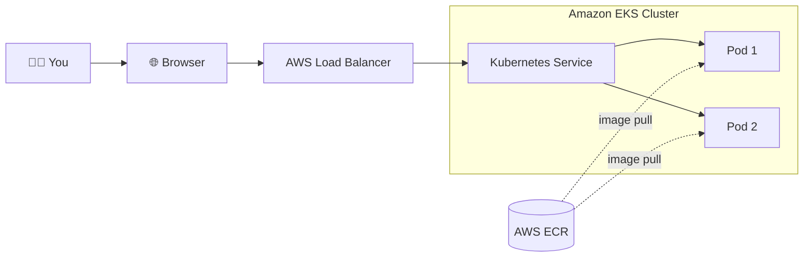
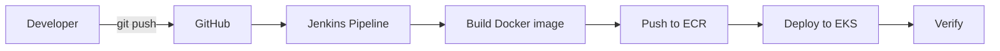

<div align="center">

# 🚀 AWS EKS ECR Application Development & Deployment

## 📑 Table of Contents

* [Overview](#-overview)
* [Project Highlights](#-project-highlights)
* [Architecture](#️-architecture)
* [Tools](#-tools)
* [Project Structure](#-project-structure)
* [Cost Rules (Read First)](#-cost-rules-read-first)
* [Quick Start](#-quick-start)
* [Monitor & Troubleshoot](#-monitor--troubleshoot)
* [Jenkins CI/CD Pipeline](#️-jenkins-cicd-pipeline)
* [Evidence & Screenshots](#-evidence--screenshots)
* [Key Results](#-key-results)
* [Clean Up](#-clean-up)
* [Key Learnings](#-key-learnings)
* [Author](#-author)

---

## 📖 Overview

This project builds a small **Node.js web app**, packages it as a **Docker image**, pushes it to **Amazon ECR**, and runs it on **Amazon EKS** (Kubernetes) behind an **AWS Load Balancer**. A **Jenkins** pipeline then automates the build, push, deploy and verify flow.

> **Learn • Build • Deploy • Scale with AWS EKS**

---

## ⭐ Project Highlights

* ✅ Deploy a simple web app on **AWS EKS**
* ✅ Push the Docker image to **AWS ECR**
* ✅ Expose the app with a **Load Balancer** or **ALB Ingress**
* ✅ Monitor and troubleshoot Kubernetes resources
* ✅ Automate the flow with **Jenkins CI/CD**
* ✅ Control costs with a cleanup script

---

## 🏗️ Architecture

```
You -> Browser -> AWS Load Balancer -> Kubernetes Service -> Pods (2 copies of the app)
                                                                ^
                               Docker image pulled from AWS ECR ┘
```



**CI/CD flow:**



---

## 🧰 Tools

| Tool | Purpose |
|---|---|
| **AWS CLI v2** | Talk to AWS from the terminal |
| **Docker** | Build and run the container image |
| **kubectl** | Manage Kubernetes resources |
| **eksctl** | Create and delete the EKS cluster |
| **Git & GitHub** | Version control and source hosting |
| **Helm** *(optional)* | Package Kubernetes manifests |
| **Jenkins** *(optional)* | CI/CD automation |

---

## 📁 Project Structure

```
aws-eks-application-deployment/
│
├── app/
│   ├── server.js                  # the web app (Node.js, no dependencies)
│   ├── package.json
│   ├── Dockerfile                 # builds the image
│   └── .dockerignore
│
├── k8s/
│   ├── deployment.yaml            # runs 2 pods with health checks
│   ├── service.yaml               # public load balancer (simple option)
│   └── alb/
│       ├── service-clusterip.yaml # ALB option, step 1
│       └── ingress.yaml           # ALB option, step 2
│
├── eks/
│   └── cluster.yaml               # eksctl cluster definition (cost-optimized)
│
├── scripts/
│   ├── ecr-push.sh                # build + push image to ECR
│   ├── create-cluster.sh          # create the EKS cluster
│   ├── deploy.sh                  # deploy the app
│   ├── install-alb-controller.sh  # optional: AWS Load Balancer Controller
│   └── cleanup.sh                 # delete everything that costs money
│
├── docs/
│   └── images/                    # overview graphic and evidence screenshots
│
├── .gitignore
└── README.md
```

---

## 💰 Cost Rules (Read First)

Approximate running cost is **$0.20–0.30 per hour** while the cluster exists. The EKS control plane alone is about **$73 per month** if left on.

* Build in sessions and run `./scripts/cleanup.sh` at the end of every session.
* Keep a billing budget alert (Billing → Budgets, for example $5 and $10).
* Use one region only: `us-east-1`.

---

## 🚀 Quick Start

### Phase 0: Setup (free)

```bash
aws sts get-caller-identity     # ARN should end in :user/<your-iam-user>, not :root
docker run hello-world
kubectl version --client
eksctl version
git --version
```

### Phase 1: Run the app locally (free)

```bash
cd app
docker build -t eks-demo-app:v1 .
docker run --rm -p 3000:3000 eks-demo-app:v1
```

Open 👉 <http://localhost:3000> and <http://localhost:3000/health>. Stop with `Ctrl+C`.

### Phase 2: Push the image to ECR (almost free)

From the repo root:

```bash
chmod +x scripts/*.sh
./scripts/ecr-push.sh v1
```

### Phase 3: Create the EKS cluster (costs start here)

```bash
./scripts/create-cluster.sh        # about 15 minutes
kubectl get nodes                  # nodes should show Ready
```

### Phase 4: Deploy and expose

**Simple option** (Service of type `LoadBalancer`):

```bash
./scripts/deploy.sh v1
kubectl get svc eks-demo-app       # wait for EXTERNAL-IP / hostname
```

Open `http://<EXTERNAL-IP hostname>` in your browser. Refresh a few times to see different pod names.

**ALB option** (Phase 4b, after the simple option works):

```bash
kubectl delete -f k8s/service.yaml
./scripts/install-alb-controller.sh
kubectl apply -f k8s/alb/
kubectl get ingress eks-demo-app   # ADDRESS column = ALB hostname
```

### Phase 5: Monitor (see next section)

### Phase 6: Tear down (every session)

See [Clean Up](#-clean-up).

---

## 🔍 Monitor & Troubleshoot

```bash
kubectl get pods                              # status of each pod
kubectl describe pod <pod-name>               # events, probe failures, image pull errors
kubectl logs <pod-name>                       # application logs
kubectl logs -l app=eks-demo-app --tail=50    # logs from all pods
kubectl get events --sort-by=.lastTimestamp   # recent cluster events
kubectl top nodes                             # needs metrics-server
kubectl scale deployment eks-demo-app --replicas=3
kubectl rollout status deployment/eks-demo-app
kubectl rollout undo deployment/eks-demo-app  # roll back a bad release
```

**Common problems**

| Symptom | Likely cause | Check |
|---|---|---|
| `ImagePullBackOff` | Wrong image URL/tag, or image not pushed | `kubectl describe pod`, check ECR |
| `CrashLoopBackOff` | App crashes on start | `kubectl logs <pod> --previous` |
| Pod `Running` but `0/1` Ready | Readiness probe failing | Path/port of `/health` |
| `EXTERNAL-IP` stays `<pending>` | Load balancer still provisioning, or subnet/permission issue | `kubectl describe svc eks-demo-app` |
| Page does not open | Security group, wrong port, or LB not ready yet | Wait 2–3 min, check target health in the EC2 console |

---

## ⚙️ Jenkins CI/CD Pipeline

The Jenkins job **`aws-eks-ecr-cicd-pipeline`** automates the manual flow: build the image, push it to ECR, deploy with `kubectl apply`, and verify the rollout.

| # | Stage | What it does |
|---|---|---|
| 1 | **Checkout** | Pulls the latest code from GitHub |
| 2 | **Build Image** | Builds the Docker image |
| 3 | **Push to ECR** | Authenticates to ECR and pushes the image |
| 4 | **Deploy to EKS** | Applies the Kubernetes manifests |
| 5 | **Verify** | Confirms rollout, pods and the `/health` endpoint |

> Build `#3` completed successfully. Builds `#1` and `#2` failed in the ECR push / EKS deployment / verification stages and were fixed before the successful run.

---

## 📸 Evidence & Screenshots

> Proof that the project works end to end. Images are stored in [`docs/images/`](docs/images/).

| # | Evidence | What it demonstrates |
|---|---|---|
| 1 |  | Project architecture, tools, repository structure, deployment workflow and key highlights. |
| 2 |  | Image `eks-demo-app:v1` exists locally; the container serves the app on port `3000` and the browser shows the welcome page. |
| 3 |  | ECR login succeeds and image layers are pushed; the `v1` tag is visible in the ECR console. |
| 4 |  | ECR repository `eks-demo-app` created in `us-east-1` with scan-on-push enabled and AES-256 encryption. |
| 5 |  | Node group `demo-nodes` is `ACTIVE`; CLI shows a node in `Ready` state and `kube-system` pods running. |
| 6 |  | Rollout completes; 2 pods `Running` and `1/1` Ready; Ingress has an ALB hostname; `curl` returns `200 OK`; `/health` returns `{"status":"ok"}`; app opens in the browser. |
| 7 |  | Jenkins job `aws-eks-ecr-cicd-pipeline` Stage View: build `#3` successful, earlier builds `#1` and `#2` failed. |

### End-to-end workflow demonstrated

1. **Build and run locally:** build the Docker image and verify the app at `http://localhost:3000`.
2. **Publish to ECR:** authenticate Docker to ECR and push `eks-demo-app:v1`.
3. **Provision/use EKS:** use the `eks-demo` cluster and its `demo-nodes` managed node group.
4. **Deploy to Kubernetes:** deploy with two replicas and verify pod readiness and rollout status.
5. **Expose the app:** use an ALB-backed Kubernetes Ingress for an external endpoint.
6. **Verify:** confirm the page responds, the root endpoint returns HTTP 200, and `/health` returns `{"status":"ok"}`.
7. **Automate:** the Jenkins Stage View records a successful pipeline run in build `#3`.

---

## 🏆 Key Results

| Item | Result |
|---|---|
| Docker image | `eks-demo-app:v1` ✅ Built and tested locally |
| ECR repository | `eks-demo-app` ✅ Image pushed (`us-east-1`) |
| EKS cluster | `eks-demo` ✅ Node group `demo-nodes` ACTIVE |
| Application pods | 2/2 Running, `1/1` Ready |
| External access | ✅ ALB Ingress hostname, HTTP `200 OK` |
| Health endpoint | ✅ `{"status":"ok"}` |
| Jenkins build | ✅ Build `#3` successful |

---

## 🧹 Clean Up

EKS control planes, EC2 worker nodes and load balancers incur charges while they exist. Run cleanup at the end of **every** work session:

```bash
./scripts/cleanup.sh              # keeps the ECR image
./scripts/cleanup.sh --with-ecr   # also removes the ECR repository
```

Check the script and your AWS resource state before running cleanup. Use the default option if you still need the ECR image.

---

## 🎓 Key Learnings

* Hands-on **AWS EKS** deployment from code to a public endpoint
* Working with **ECR**, **Load Balancer** and **ALB Ingress**
* **Monitoring and troubleshooting** Kubernetes apps (`describe`, `logs`, `events`, `rollout`)
* Automating build, push and deploy with **Jenkins CI/CD**
* **Best practices for cost control**: budgets, IAM users, one region and strict cleanup
* **Verifying** deployments with health checks instead of assuming they worked

---

## 👩‍💻 Author

### **Divya Mirapakayala**

**DevOps Engineer (Aspiring) | Kubernetes • Helm • Jenkins • Docker • AWS**

I deployed, tested and debugged this project end to end on AWS EKS.

[](https://github.com/divyadevops14)
[📧 Contact Me](mailto:divyamirapakayala1@gmail.com)

<sub>🛠️ Tools used along the way: Claude and ChatGPT as AI assistants for guidance and troubleshooting.</sub>

---

<div align="center">

**Aspiring AWS DevOps Engineer | Building Cloud Solutions • Automating Deployments • Open to Collaboration**

</div>